# NZ Transport Planner

macOS menu bar app that tells you when to walk out of the office so you arrive at the bus stop just before the bus, not fifteen minutes early. Uses Auckland Transport timetable data. This is an independent community project and is not affiliated with or endorsed by Auckland Transport.

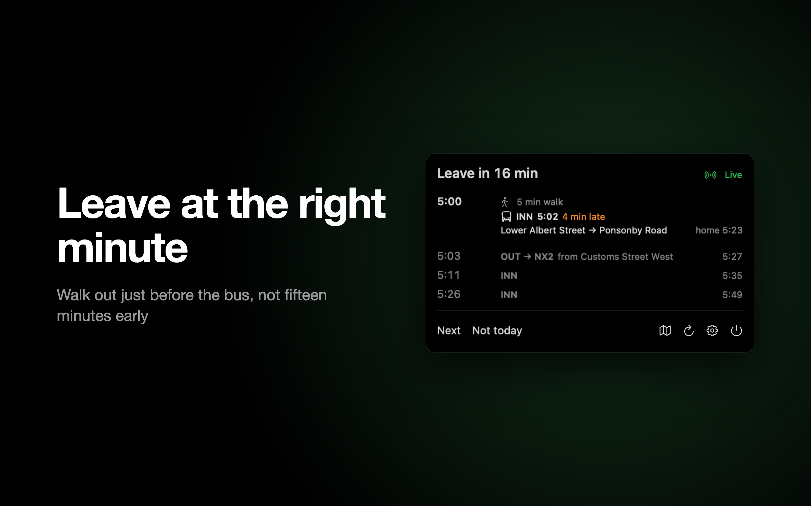

| | |
|---|---|
| 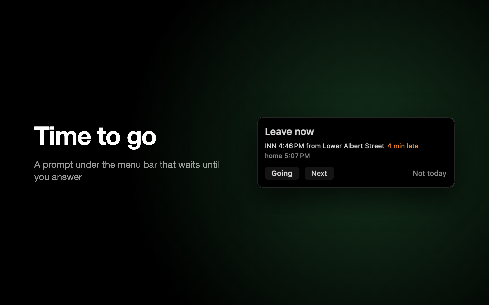 | 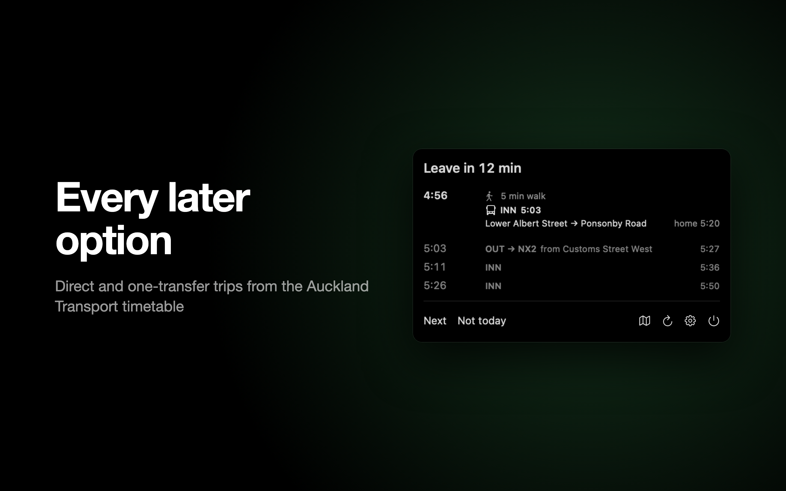 |
| 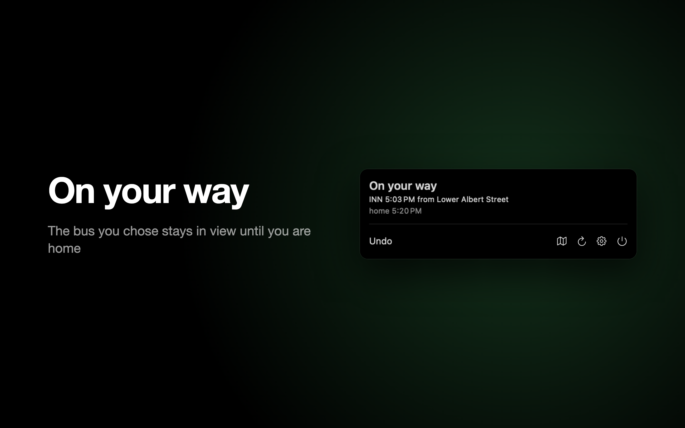 | 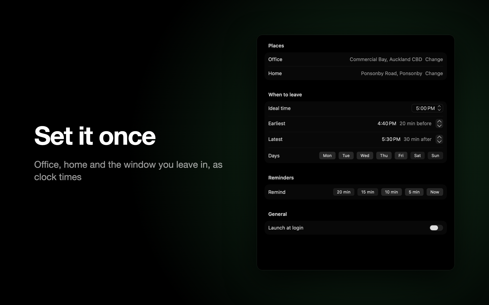 |

## What it does

- Downloads the public Auckland Transport GTFS timetable (no API key) into a local SQLite database, and once that copy is six days old, checks hourly and re-downloads when AT publishes a new file.
- Finds every direct and one-transfer journey from stops near your office to stops near home, within the window you are happy to leave in.
- Picks the journey closest to your ideal leave time, weighing travel time and transfers, and shows a countdown in the menu bar. The countdown turns orange 10 minutes out and red at the leave time.
- Sends staged notifications (default 10 min, 5 min, now) for one bus inside the leave window, with "Next" and "Not today" actions, plus "Going" from 10 minutes out. Each reminder replaces the last, and answering clears them. A missed bus gets one notice and a single "leave now" for the next; a second miss goes quiet.
- At the leave time (with the Now reminder on and you at the office), shows a panel under the menu bar that stays until you answer Going, Next or Not today. It follows realtime changes to that bus while it is open.
- Uses the Mac's location to stay quiet away from the office: no countdown, notifications or panel at home. Without location access it reminds you anywhere.
- Warns in the popover when notifications are not allowed, hidden, or set to vanishing banners, with a Fix button.
- Optionally applies live delays and cancellations from the AT Realtime API if you paste a free developer key.
- Falls back to an Apple Maps transit estimate, counting down like a plan, when the timetable cannot plan (not downloaded yet, no usable stops, a failed plan). When the timetable simply has no bus left, it says so instead of guessing. The commute can be opened in Apple Maps.

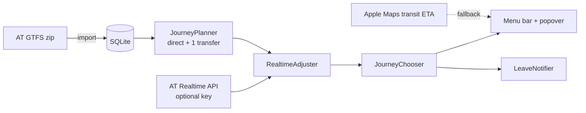

## Build

Requires Xcode 26 and [xcodegen](https://github.com/yonaskolb/XcodeGen).

```sh
git clone https://github.com/wezzcoetzee/transport-planner-nz.git
cd transport-planner-nz
xcodegen generate
xcodebuild -project NZTransportPlanner.xcodeproj -scheme NZTransportPlanner -configuration Release -derivedDataPath build/DerivedData build
open build/DerivedData/Build/Products/Release/NZTransportPlanner.app
```

Or open `NZTransportPlanner.xcodeproj` and run. The app has no dock icon; look for the bus in the menu bar.

To package a disk image for installing on another Mac:

```sh
./scripts/build-dmg.sh   # writes dist/NZTransportPlanner-<version>.dmg
```

The build is ad-hoc signed, not notarised. On first open, right-click the app and choose Open, or allow it under System Settings > Privacy & Security.

## Setup

1. Settings opens on first launch (later, click the bus in the menu bar, then the gear). Set Office and Home by searching an address.
2. Allow notifications and Location Services when asked; the prompts appear once both places are set. Set the notification style to Persistent so reminders wait for you.
3. Set your ideal leave time and how early or late you are willing to go. Settings shows the window as clock times.
4. On the Route tab, choose direct only or up to one transfer, how early to be at the stop, how far to look for stops, your walking pace, and turn off any stops you would never use.
5. Optional live data: sign up at [dev-portal.at.govt.nz](https://dev-portal.at.govt.nz), subscribe to the Realtime API, and paste the primary key into AT key on the Data tab.

The first launch downloads and imports the timetable. Download size and import time depend on the current feed and your Mac.

## How the plan is chosen

For each candidate boarding at an origin stop, the leave time is `departure - walk - buffer`. Journeys that leave earlier and arrive later than another are dropped. The remaining journeys are scored by distance from your ideal leave time (leaving late costs more than leaving early), half the travel time, and a penalty per transfer. As the moment approaches the app polls more often; with a realtime key a late bus shifts the leave time and a cancelled one is skipped.

## Screenshots

`screenshots/raw/mac` holds every screen and state straight from the app; `screenshots/framed/mac` holds the App Store set at 2880x1800, with the headlines in `screenshots/manifest.json`. One script rebuilds both from a Debug build with a fixed Auckland commute, no timetable or network needed. It pins the clock to the late afternoon and the locale to en_NZ, and frames with headless Chrome:

```sh
./scripts/screenshots.sh
```

Every state the raw set covers:

| Popover | | |
|---|---|---|
| 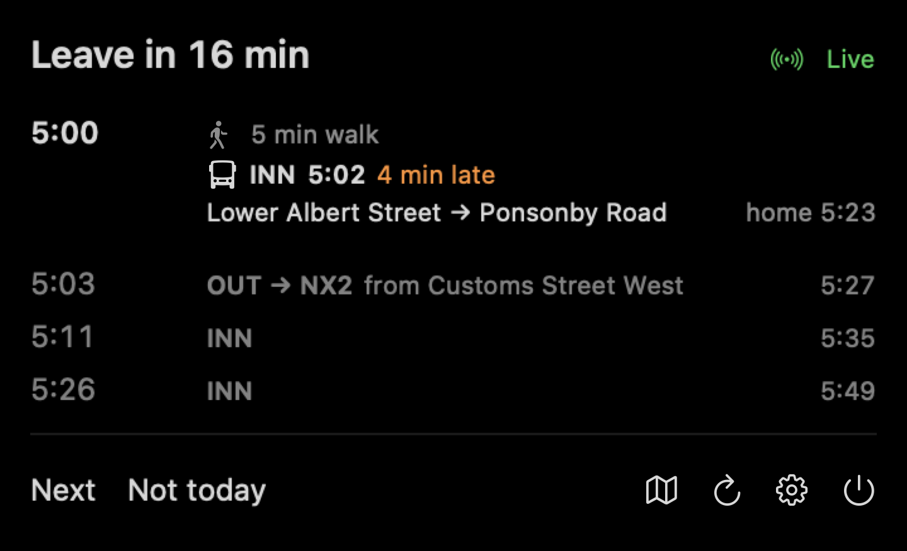 | 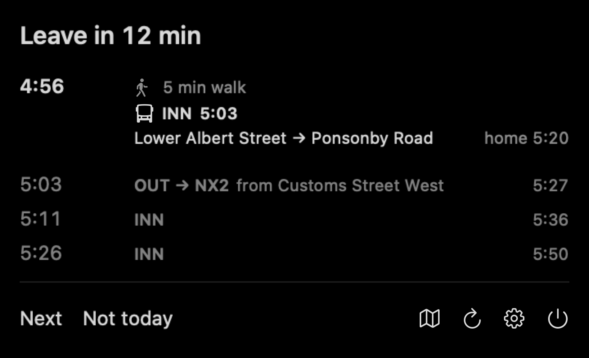 | 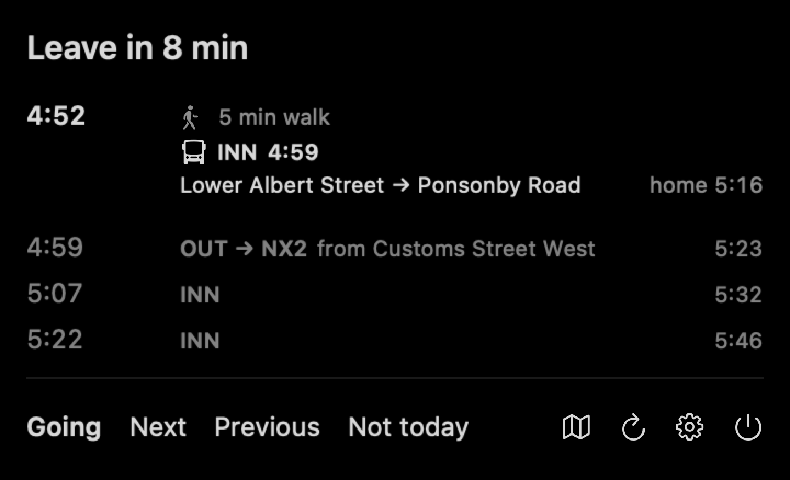 |
| 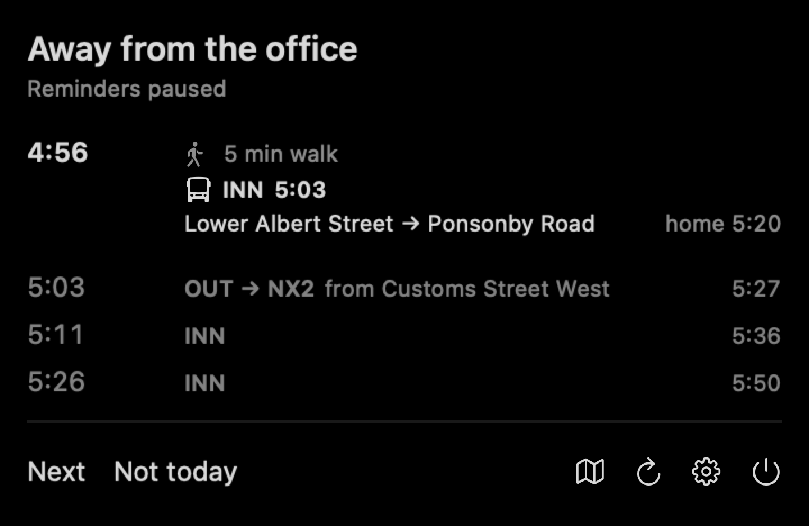 | 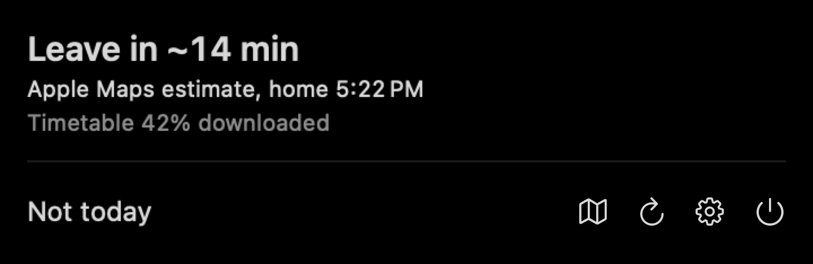 | 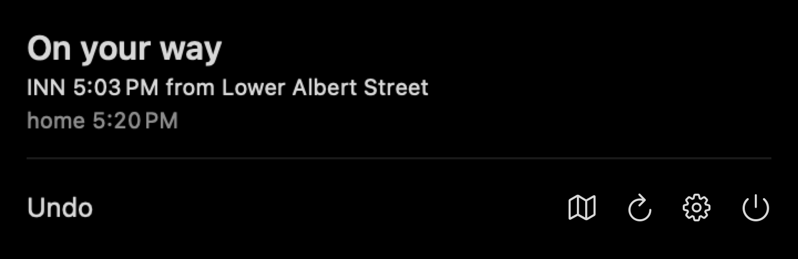 |
| 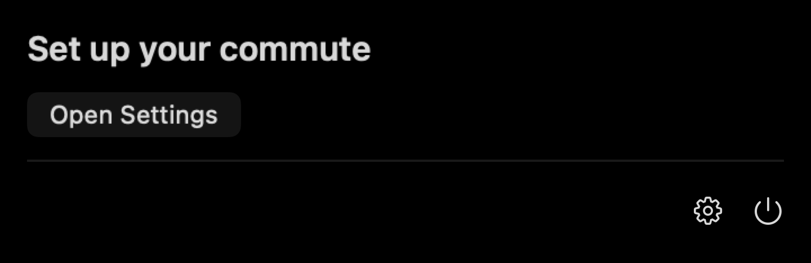 | 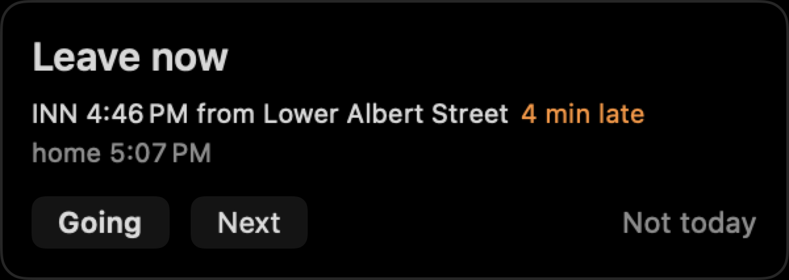 | |

| Menu bar: calm | Soon | Go |
|---|---|---|
|  |  |  |

| Settings: Commute | First run | Route | Data |
|---|---|---|---|
| 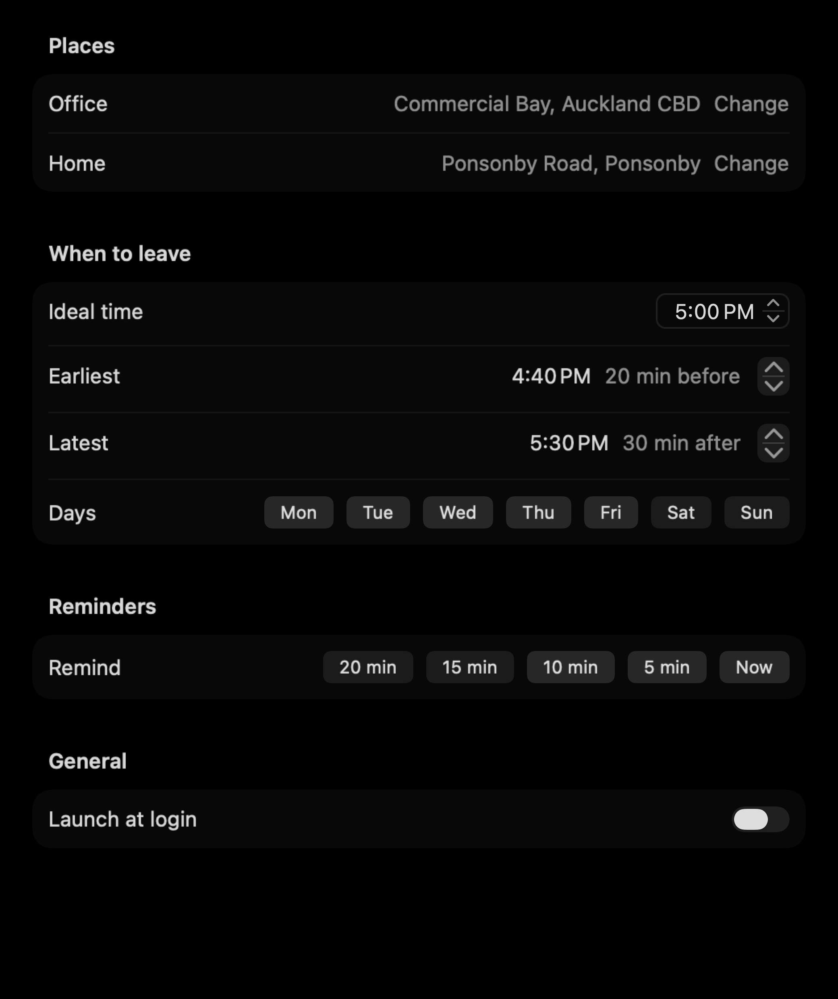 | 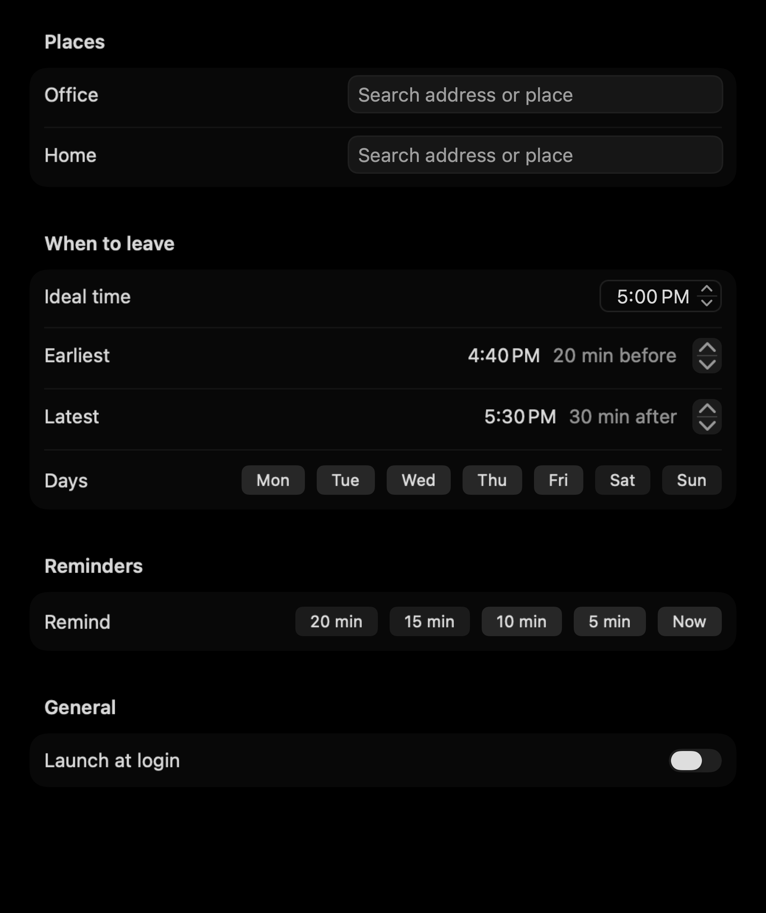 | 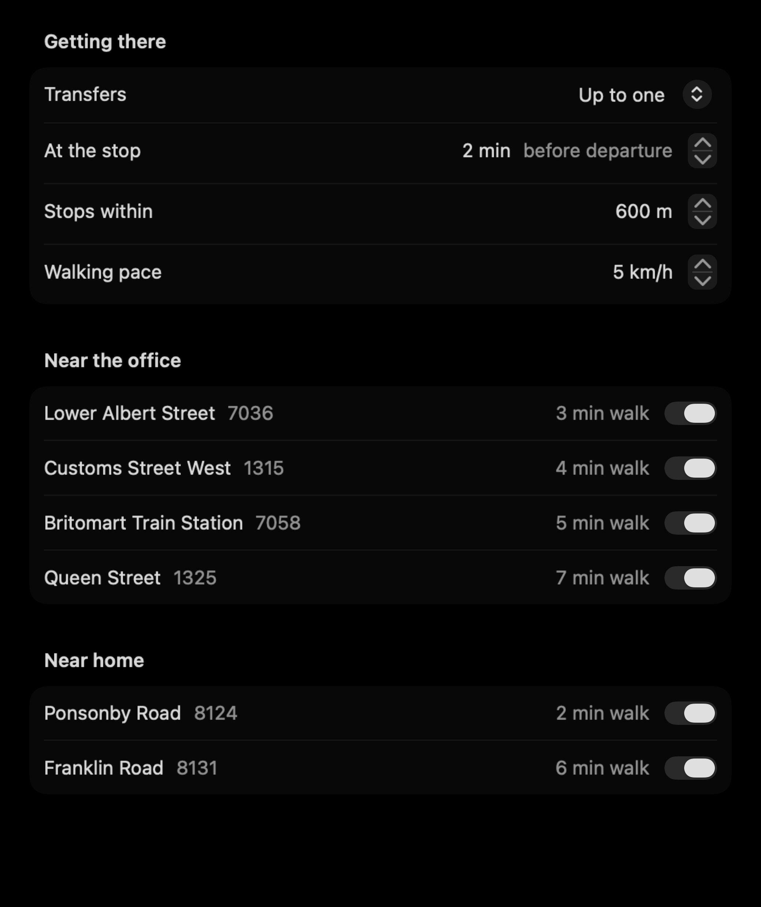 | 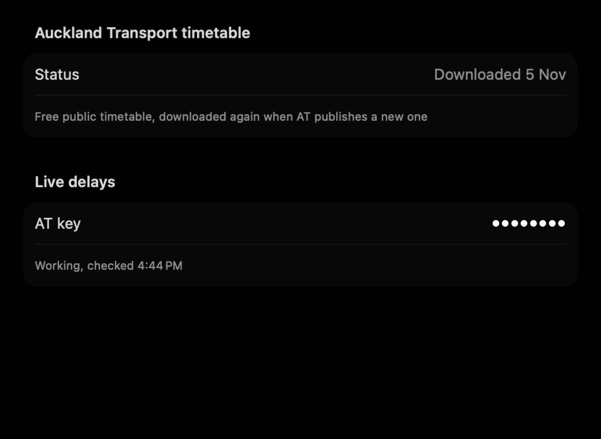 |

## Tests

```sh
xcodegen generate
xcodebuild -project NZTransportPlanner.xcodeproj -scheme NZTransportPlanner -destination 'platform=macOS' -derivedDataPath build/DerivedData test
```

Unit tests use a small synthetic feed. An end-to-end test against the real AT feed runs only if the feed is extracted to `/tmp/at_gtfs`:

```sh
curl -o /tmp/at_gtfs.zip https://gtfs.at.govt.nz/gtfs.zip && mkdir -p /tmp/at_gtfs && unzip -o /tmp/at_gtfs.zip -d /tmp/at_gtfs
```

## Files

- `~/Library/Application Support/NZTransportPlanner/gtfs.sqlite` imported timetable
- `~/Library/Application Support/NZTransportPlanner/app.log` rolling trace of imports, plans and notifications

## Privacy and credentials

Office and Home start empty. Addresses, coordinates, commute preferences, and the optional AT key are stored locally in macOS UserDefaults. The key is not stored in Keychain or encrypted separately by the app. Do not share your preferences file or paste a key into source code or an issue.

Address searches and fallback transit estimates use Apple Maps services. Opening a journey in Maps passes the selected origin and destination to Maps. Timetable downloads contact Auckland Transport; optional realtime requests send trip identifiers and the AT key to its API. Location access is used to determine whether reminders should fire at the configured office.

The app writes local diagnostic logs containing journey summaries, stops, times, presence status, and errors. Review and redact logs before sharing them. Build products, local credentials, logs, and timetable databases are excluded by `.gitignore`.

## Contributing

Issues and pull requests are welcome. Describe the problem, include reproducible steps, and run the synthetic tests before submitting a code change. Use invented locations and placeholder credentials in examples. Review the staged diff for personal data, secrets, and generated files before committing. Do not attach preferences, raw logs, or screenshots containing addresses or keys.

The generated Xcode project is intentionally ignored; update `project.yml` and regenerate it with XcodeGen. `PRODUCT.md` and `DESIGN.md` describe the product and interface conventions.

## License

Distributed under the [MIT license](LICENSE). Auckland Transport data and Apple services remain subject to their providers' terms; the source license does not grant rights to third-party data or services.
